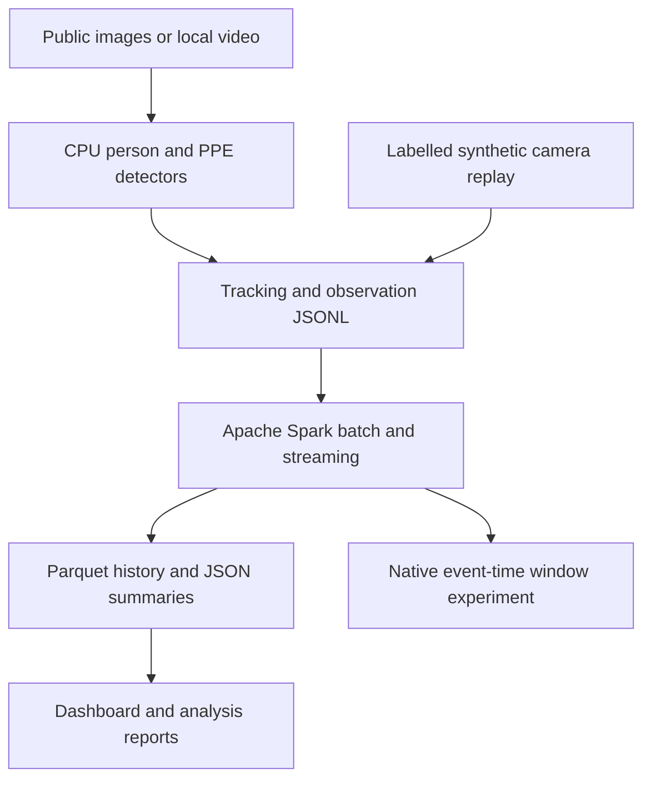

# Mine Safety Observatory — Apache Spark + Computer Vision

**Author:** Md Azam Hussain · [az4mm](https://github.com/az4mm)

Safety and risk analytics for mines using computer vision, developed for
**Distributed Analytics for Industrial Automation (IM60210)** with
**Apache Spark (PySpark)**.

## Project introduction

This project explores how computer vision and distributed analytics can support
safety monitoring in mines. It focuses on **helmet use** and **entry into
configured restricted areas**. Pretrained computer vision models detect people
and assess helmet evidence, recording unclear predictions as **unknown**. A
dashboard presents annotated images, safety observations, incident summaries,
and trends.

**Apache Spark** is the main analytics engine. It validates observations,
removes duplicates, applies safety rules, and produces summaries through batch
and streaming processing. Public images demonstrate actual model inference,
while a clearly labelled synthetic camera replay demonstrates time-based
incidents, streaming recovery, and performance experiments. This is a course
prototype, with its accuracy limitations and need for mine-specific validation
documented.

## Start here

| What you want to do | Open |
|---|---|
| Run the application on your own computer | [Windows and Linux quickstart](docs/QUICKSTART.md) |
| Understand exactly how Spark is used | [Spark implementation and experiments](docs/SPARK.md) |
| Check models, data, licenses and CV results | [Data and computer vision notes](docs/DATA.md) |
| Inspect recorded experiments | [Public results and benchmark evidence](reports/) |

Start the Python application to use the dashboard and run Spark processing.
The dashboard page at `web/index.html` expects the application's local API
server; use the commands below to serve it.

## Quick demo: three commands

Prerequisites: Python 3.12, an activated virtual environment, and Java 17 or 21
available to Spark. The project was tested on Linux with Python 3.12 and Java 21.
[Quickstart](docs/QUICKSTART.md) includes the initial setup and Windows commands.

Run from this project directory:

```bash
python -m pip install -r requirements.txt
python -m mine_safety batch --input data/demo/events.jsonl --output outputs/current
python -m mine_safety serve
```

Open [http://127.0.0.1:8000](http://127.0.0.1:8000). The bundled input has 720
**synthetic** observations from three cameras. The dashboard can run another
Spark batch or start a new streaming replay. The first Spark start takes time;
job status and logs show progress.

This quick demo does not download models. Follow the next section to reproduce
the actual computer vision experiment and send its output through Spark.

## Full public-image workflow

```bash
python scripts/fetch_model.py
python scripts/fetch_public_data.py --labelled-sample
python scripts/run_public_vision.py --include-labelled-sample
python -m mine_safety batch --input outputs/vision/observations.jsonl --output outputs/vision_analytics
python -m mine_safety.vision_evaluation
python -m mine_safety serve
```

The downloads use public sources, with no API key. Two CPU ONNX models total
approximately 25 MB. Their revisions, SHA256 hashes and licenses are pinned in
[the PPE manifest](models/MANIFEST.json) and
[the person-model manifest](models/PERSON_MODEL_MANIFEST.json). The project uses
pretrained models; it does not claim to have trained a new mine detector.

The recorded workflow processed 23 public images, including a genuine
underground mine photograph. It produced **73 model-derived person observations:
50 helmet-present, 5 helmet-absent and 18 unknown**. The actual public-image
observations pass through Spark independently of the synthetic replay.
See [the experiment details and source register](docs/DATA.md).

## Architecture



Computer vision runs outside Spark. Spark is responsible for schema validation,
deduplication, safety-rule joins, episode aggregation, exposure summaries,
one-minute camera trends, persistent outputs, replay recovery, and a separate
native event-time window/watermark experiment.

The prototype monitors helmet evidence and configured restricted regions. A
person's missing helmet is inferred only from an explicit model prediction;
missing or conflicting head evidence is `unknown`. A continuous video episode
keeps one ID across its observations. Pixel polygons describe configured image
regions; they do not measure real-world vehicle clearance.

## What was measured

### Public computer vision

The fixed first 20 labelled public test images were selected before inference.
At confidence 0.35 and same-class IoU 0.50:

| Class | True positive | False positive | False negative | Precision | Recall |
|---|---:|---:|---:|---:|---:|
| Hardhat | 44 | 11 | 21 | 80.00% | 67.69% |
| No-hardhat | 3 | 5 | 9 | 37.50% | 25.00% |
| Micro total | 47 | 16 | 30 | 74.60% | 61.04% |

This is a small construction/web sample. Overlap with the pretrained model's
upstream training data is unknown. These are **descriptive sample results, not
an independent mine-domain benchmark**. mAP is not measured. Low no-hardhat
recall is a measured limitation, and the system is presented as a prototype
for review. Reproduce the numbers with `mine_safety.vision_evaluation`; details
and per-image evidence are documented in [DATA.md](docs/DATA.md).

### Apache Spark

The reproducible synthetic scenario produces 5 missing-helmet episodes and 4
restricted-zone episodes. Duplicate observation IDs are counted once, and
unknown helmet time is excluded from assessable helmet compliance.

The analytics benchmark ran on 10,000, 100,000 and 1,000,000 synthetic rows with
three measured repetitions per configuration. It times a warmed, cached Spark
join-and-window query, including result collection; it excludes video decoding,
CV inference and Spark startup. It does not measure full-camera throughput.

`local[1]` and `local[2]` compare threads on one host. Linux scripts also run one
standalone master and two worker processes on that host. That demonstrates Spark
cluster scheduling; it is not a claim of multi-machine speedup. See
[SPARK.md](docs/SPARK.md) for the measured runs and reproduction commands.

## Main files

| Location | Contents |
|---|---|
| [mine_safety/](mine_safety/) | Computer vision, tracking, simulation, Spark jobs, benchmark, API and CLI |
| [web/](web/) | Dashboard interface |
| [scripts/](scripts/) | Setup, model/data downloads, public inference, video smoke and cluster helpers |
| [tests/](tests/) | Meaningful checks for safety semantics, analytics, replay and API behaviour |
| [data/demo/](data/demo/) | Deterministic synthetic events, scenarios and expected results |
| [data/PUBLIC_DATA_MANIFEST.json](data/PUBLIC_DATA_MANIFEST.json) | Photo/dataset sources, licenses and hashes |
| [data/HARDHAT_SAMPLE_MANIFEST.json](data/HARDHAT_SAMPLE_MANIFEST.json) | Fixed twenty-image sample IDs, ground truth and hashes |
| [models/](models/) | Pinned model provenance; downloaded weights are excluded from Git |
| [docs/](docs/) | Setup, Spark implementation, data provenance and evaluation notes |
| [reports/](reports/) | Public benchmark results, evaluation records and attributed example predictions |
| `outputs/` | Generated Spark and CV results; recreated by the commands above |
| `checkpoints/` | Generated Spark streaming recovery state |

Public data sources and original authors are credited in the manifests and
data notes.

## Verification

The recorded test run passed **25 tests**, including real Spark integration
tests; its [JUnit record](reports/test_results.xml) is included. A separate
[API and streaming integration run](reports/end_to_end.json) exercised the real
Spark child process, consumed all 720 synthetic observations, checked the
expected episode counts, and stopped the job successfully. These are programmatic
checks of the application and processing pipeline.

```bash
python -m pip install -e ".[dev]"
python -m pytest tests/test_simulation.py tests/test_server.py tests/test_vision.py -q
python -m pytest tests/test_spark.py -q
python scripts/verify_project.py --runtime
```

The Spark test command requires a working Java installation and runs real Spark
jobs. The verification script checks the public source files, manifests and
environment. After reproducing the public-image workflow, add `--results` to
check downloaded model hashes and result consistency. It does not launch
another Spark benchmark or train a model.

## Result interpretation

Still images can support object predictions, but do not establish exposure time
or persistent incidents. They are excluded from time-based compliance and
incident KPIs. Camera track IDs are not real identities and are not deduplicated
across cameras. The synthetic replay is clearly labelled throughout.

The project implements a course prototype for human review, with documented
failure cases and source provenance. It does not claim mine-specific training,
deployment validation, accident-probability calibration, or automatic machine
shutdown.

## License and upstream sources

Project code is released under [AGPL-3.0-or-later](LICENSE). Downloaded models
retain their upstream AGPL-3.0 terms. Images and annotations retain their own
CC BY / CC0 licenses; the project code license does not replace those terms.
See [DATA.md](docs/DATA.md) and the manifests for attribution and modifications.

Primary technical references: [Apache Spark 4.0.1](https://spark.apache.org/docs/4.0.1/),
[PySpark installation](https://spark.apache.org/docs/4.0.1/api/python/getting_started/install.html),
[Structured Streaming](https://spark.apache.org/docs/4.0.1/streaming/index.html),
[SafetyVision model](https://huggingface.co/ayushgupta7777/safetyvision-yolov8),
and [public Hard Hats dataset](https://huggingface.co/datasets/keremberke/hard-hat-detection).
